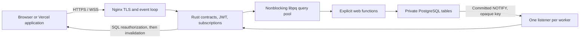

# Runtime architecture

The Nginx master manages workers. Each worker is single-threaded and owns an independent Rust state machine and database pool. Increase workers deliberately: connections grow as `workers × (pool_size + 1)`, with temporary overlap during reloads. A small VPS starts with one worker. A larger machine can add workers and pool capacity after measuring database contention and tail latency.

The optional `borrowed-libpq` build and `pgxio_libpq_buf borrowed` use leased
Nginx body segments for raw REST input. Rust retains descriptors until libpq has
flushed them. Request cleanup closes a connection still referencing a body before
Nginx frees its pool; after flush the ordinary cancel/rollback path applies.
Shutdown disposes of DB references before finalizing HTTP requests. Schema-enabled
input and WebSockets retain the copied path. See the
[experimental guide](../patches/libpq/README.md) for the C contract and limits. The default, `pgxio_libpq_buf auto`,
conservatively borrows plaintext input of at least 16 KiB with at least 4 KiB per
nonempty segment. Every query connection must have confirmed plaintext transport;
reconnects clear that cached state. Dispatch rechecks the actual acquired
connection. TLS, GSS, unknown transport, schema validation and system-libpq
builds select copying. The legacy boolean directive has been removed.

Nginx socket readiness drives `PQconnectPoll`, `PQflush`, `PQconsumeInput`, and `PQgetResult`. Database sockets belong to libpq; the adapter registers borrowed descriptors with Nginx and unregisters them before `PQfinish`. Nginx timers track the nearest acquisition, execution, cancellation, or recovery deadline. Periodic maintenance handles reconnect backoff, token expiry, and heartbeat; it does not poll for query results.

With `pgxio_libpq_buf copy`, REST input uses a body-sized owned buffer, including a trailing NUL for libpq text parameters. Chained Nginx buffers are consolidated once; ownership moves from the bounded waiting queue into the database command. In copy mode no Nginx body pointers cross asynchronous callbacks. PostgreSQL receives the original bytes. Optional `pgxio_validate_input` checks a temporary parsed tree and discards it without reserialization. UTF-8 client encoding is requested during asynchronous connection startup and checked after connection establishment.

Healthy libpq connections persist across requests. Each transaction passes through BEGIN → local claims/timeouts → parameterized function → optional output validation → COMMIT. Prepared settings/function statements are created lazily on each connection. Their names and SQL derive from validated Nginx endpoint declarations, so client inputs cannot grow the statement registry. With pipelining enabled, BEGIN, settings and function execution share one synchronized batch; COMMIT is sent only after the full batch is drained, result metadata and enabled schema checks pass and the JWT is still current. One connection runs one caller's transaction at a time.

On SQL errors or invalid output, results are drained and ROLLBACK restores the session. Cancellation uses libpq 17's nonblocking cancel connection, with the original TLS requirements, followed by draining and rollback. A connection remains unavailable until cancellation has completed and the original session is transaction-idle. Cancellation and rollback each have a one-second recovery deadline; transport/protocol failures or unsuccessful recovery close the connection and reconnect with the existing role audit. Stale statement errors fail the current request, then reset server/client preparation state before another caller uses the session. There is no automatic write retry: a connection failure during commit can leave the client uncertain whether a write committed. Applications needing retries should implement idempotency in their SQL contract.

Tungstenite parses frames over Nginx's `recv`/`send` callbacks, including TLS. Handshake preread bytes are preserved, header output is flushed before frames, and per-socket buffers are bounded. Finalization occurs outside Rust's worker borrow because Nginx cleanup callbacks can run synchronously. Worker exit explicitly closes retained requests before dropping database state.

## Choice of runtime

| Option | Advantages | Costs |
|---|---|---|
| Rust Nginx module, selected alpha | Existing TLS/event loop; Rust ownership for application state; no second HTTP server or async runtime | Unsafe FFI remains; exact Nginx build compatibility; request lifetimes and reload behavior are subtle; panic/crash affects the worker |
| C Nginx module | Direct access to Nginx APIs; potentially small artifact | Manual memory and protocol state management; larger burden for keeping application code safe |
| Standalone Rust | Simpler HTTP/WebSocket integration and operational separation | Another server/runtime when Nginx is also deployed; different footprint to measure |
| OpenResty/LuaJIT | Mature Nginx integration and WebSocket library; fast application iteration | Must implement the same SQL/JWT/stream authorization product layer; relative memory/CPU is a benchmark question |

Rust has no garbage collector and does not inherently require a thread pool. This implementation does allocate JSON values, schema validators, JWT data, and socket buffers. TLS and libpq retain C code. Neither “zero overhead” nor “Rust makes the whole worker memory-safe” is a valid claim.

Build the module and Nginx together. The Dockerfile uses Nginx 1.30.5 and pins the ngx-rust revision; `Cargo.lock` fixes Rust dependency resolution. Distro Nginx binaries can differ in configuration, patches, and ABI. Do not copy this `.so` into an unrelated Nginx installation.

Alpha constraints: DNS is resolved by deployment tooling into `hostaddr`, not inside the worker; address changes require refreshing the URL and replacing the container. JWKS updates require an atomic file update and worker reload. The 1 MiB output check occurs after libpq receives the value, so trusted SQL must also bound result sizes. These are documented limits, not hidden background services.

## Admission and authentication resources

Each worker admits at most `pool_queue_limit` waiting jobs (default 32), independently of the active database pool. HTTP acquisition waits up to `pool_acquisition_timeout_ms` (default 1,000 ms); a full queue returns 503 `busy`, while an elapsed acquisition deadline returns 503 `pool_timeout`. Zero timeout selects immediate rejection, and zero queue capacity prevents waiting. Queued cancellations are removed; queued tokens are checked again before execution. Busy healthy connections remain ready. Listener availability is still required by readiness.

WebSocket invalidations keep one dirty marker per subscription and rotate deferred authorizations in FIFO order. Only admitted jobs clone their JSON inputs. Notifications coalesce while authorization is queued or running. Every delivery still requires a fresh authorization query; a full queue defers subscriptions rather than closing them.

Signing keys and validation policies are constructed at worker startup. The optional JWT cache is worker-local, positive-only and LRU. Entries use SHA-256 token digests, expire after the earlier of token expiry or 30 monotonic seconds, and recheck wall-clock expiry on every hit. `jwt_cache_max_entries` defaults to zero. When enabled, `jwt_cache_max_bytes` defaults to 1 MiB of serialized claims plus digests; metadata and allocator overhead are additional and bounded by the entry limit. Reload constructs a fresh verifier/cache. No database permission or stream-authorization result is cached.

## Configuration and output ownership

Nginx parses native `pgxio_*` directives. The C adapter passes string slices through a typed ABI to Rust, which builds an owned configuration/routing snapshot and validates the optional version-2 contract during configuration testing and reload. A Nginx pool cleanup releases the snapshot. Forked workers clone their inherited snapshot; no request depends on configuration-parser memory. Database credentials and JWT policies are initialized in workers.

For HTTP results, libpq must report one row and one non-NULL text-format JSONB column, no larger than 1 MiB. Rust copies the bytes before `PQclear`, holds them through transaction completion, and sends them only after successful COMMIT. With output checks off there is no response JSON tree or JSON serialization. With checks on a temporary parsed value is validated and discarded; successful responses still use the original PostgreSQL bytes. This preserves numeric text and PostgreSQL formatting. Internal role audits and stream authorizations remain parsed and checked. Nginx's response buffer still requires a copy; this is not a claim of zero-copy output.
